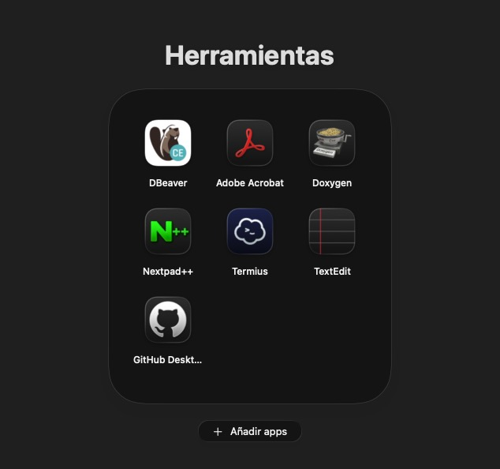
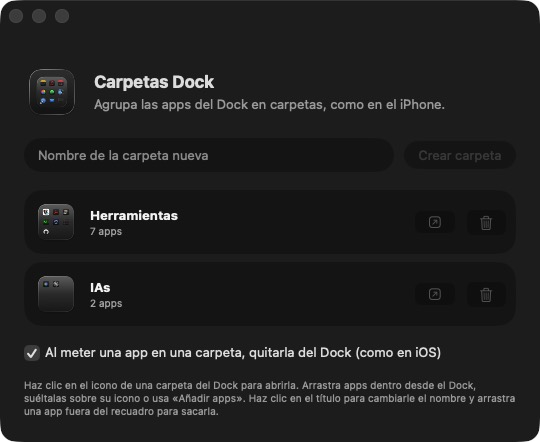

# Carpetas Dock

**Carpetas de apps para el Dock del Mac, como en el iPhone.** Agrupa tus apps por temas
(Herramientas, Redes, Estudio…) en carpetas que viven en el Dock, se abren con la misma
animación que en iOS y usan el estilo *Liquid Glass* de macOS 26.

<p align="center">
  
  &nbsp;&nbsp;
  
</p>

## Qué hace

- **Carpetas en el Dock** con una miniatura en vivo de sus 9 primeras apps.
- **Se abren como en iOS**: salen desde el propio icono, el escritorio se difumina y el
  nombre aparece encima. Clic fuera o `Esc` para cerrar.
- **Arrastra apps desde el Dock** y suéltalas sobre la carpeta abierta. Como en iOS,
  la app sale del Dock y entra en la carpeta (y vuelve al Dock si la sacas).
- También puedes **soltar apps sobre el icono** de la carpeta (desde el Finder o
  Aplicaciones) o usar el botón **Añadir apps**, con buscador.
- **Reordena** arrastrando los iconos dentro de la carpeta; arrástralos **fuera** para sacarlos.
- **Nombre editable**: haz clic en el título.
- Varias páginas si hay más de 9 apps.
- Las carpetas se abren solas al iniciar sesión. Con la carpeta cerrada no se ejecuta nada
  en segundo plano (0 % de CPU, unos 30 MB de memoria por carpeta).

## Requisitos

- **macOS 26 (Tahoe)** o posterior. Apple Silicon o Intel.
- Las herramientas de línea de comandos de Apple con el SDK de macOS 26
  (vienen con Xcode 26, o `xcode-select --install`).

## Instalación

```bash
git clone https://github.com/amaestra205/carpetas-dock.git
cd carpetas-dock
./build.command
```

También puedes hacer **doble clic en `build.command`** desde el Finder. Compila la app,
la instala en `/Aplicaciones` (o en `~/Aplicaciones` si no tienes permiso) y la abre.
Si algo falla, el detalle queda en `build.log`.

> La app no está firmada con un certificado de Apple: se compila en tu propio Mac y se firma
> localmente, por eso no hace falta pasar por Gatekeeper.

## Uso

1. Abre **Carpetas Dock**, escribe un nombre y pulsa **Crear carpeta**. Aparece en el Dock.
2. Haz clic en la carpeta del Dock para abrirla.
3. Para meter apps:
   - arrastra un icono **desde el Dock** hasta que salga «Eliminar» y suéltalo sobre la carpeta
     abierta (el Dock tarda 2–4 s en soltarlo; mientras, el recuadro sigue iluminado);
   - o suelta apps del Finder sobre el **icono** de la carpeta;
   - o usa **Añadir apps**.
4. Clic derecho sobre la carpeta en el Dock: nueva carpeta, cambiar nombre, gestionar o eliminar.

En la ventana de Carpetas Dock puedes desactivar que las apps se quiten del Dock al meterlas
en una carpeta.

## Cómo funciona

macOS no permite añadir «carpetas de apps» al Dock, así que cada carpeta es **una copia
ligera de la propia app** con su identificador, guardada en `~/Applications/Carpetas Dock/`.
Al ser una app, puede dibujar su icono del Dock en vivo y abrir su ventana al hacer clic.

- La configuración de cada carpeta está en `~/Library/Application Support/CarpetasDock/folders/`.
- Para quitar o devolver apps al Dock se edita su preferencia `persistent-apps` y se reinicia
  el Dock (un parpadeo de un segundo).
- El Dock no entrega sus iconos al arrastrarlos fuera; la carpeta abierta detecta que has
  soltado un icono encima y espera a que el Dock lo quite para añadirlo.

```
Sources/
  App.swift              arranque, menú del Dock y eventos de la app
  FolderController.swift estado de una carpeta: abrir/cerrar, apps, arrastres desde el Dock
  FolderOverlay.swift    interfaz de la carpeta abierta (SwiftUI + Liquid Glass)
  DropHost.swift         recepción de apps arrastradas desde el Finder
  Manager.swift          ventana para crear y borrar carpetas
  Bundles.swift          crear, renombrar y borrar las apps de cada carpeta
  Icons.swift            miniatura de la carpeta para el Dock
  Support.swift          modelo, almacenamiento y acceso a las preferencias del Dock
scripts/medir.command    muestra la CPU y memoria que usa cada carpeta
```

## Limitaciones conocidas

- Soltar un icono del Dock **sobre el icono de la carpeta en el Dock** solo lo cambia de
  sitio: eso lo gestiona macOS. Hay que abrir la carpeta y soltarlo dentro.
- Al iniciar sesión puede verse un instante el icono genérico de la carpeta antes de que
  aparezca la miniatura.
- La reordenación funciona dentro de cada página (no se arrastran apps entre páginas).

## Desinstalar

1. En **Carpetas Dock**, elimina tus carpetas (las apps que vinieron del Dock vuelven a él).
2. Borra `/Aplicaciones/Carpetas Dock.app`, la carpeta `~/Applications/Carpetas Dock` y
   `~/Library/Application Support/CarpetasDock`.

## Depuración

Para activar el registro: `mkdir -p ~/Library/Logs/CarpetasDock && touch ~/Library/Logs/CarpetasDock/debug.log`
y vuelve a abrir las carpetas. Para desactivarlo, borra ese archivo.

## Licencia

[MIT](LICENSE)
